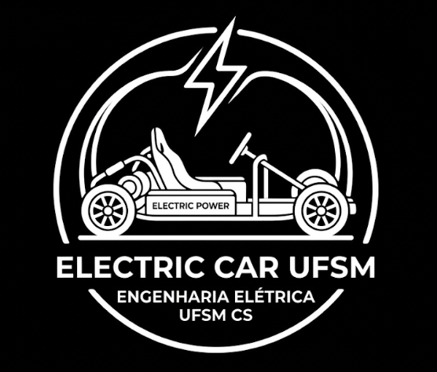
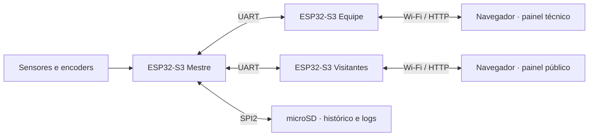

  
  <h1>Carro Elétrico UFSM-CS</h1>
  
<strong>Um laboratório em movimento.</strong>

  
Instrumentação, telemetria e controle experimental · Universidade Federal de Santa Maria — Campus Cachoeira do Sul

  

    <a href="#o-projeto">O projeto</a> ·
    <a href="#o-sistema">O sistema</a> ·
    <a href="#por-onde-começar">Por onde começar</a> ·
    <a href="documentacao/README.md">Documentação completa</a>
  

---

## O projeto

O carro reúne, em um veículo experimental, conhecimentos de circuitos,
acionamentos, programação, energia, medição e mecânica. Construí-lo e testá-lo
permite que estudantes confrontem hipóteses com dados reais e entendam como as
decisões de uma área afetam as demais.

A instrumentação torna esse aprendizado observável e compartilhável. A equipe
acompanha leituras e falhas durante os testes; visitantes podem conhecer o
movimento do veículo por um painel de leitura simples. O projeto também busca
aproximar a universidade da comunidade e despertar interesse pela engenharia e
pela mobilidade elétrica.

## O sistema

Três ESP32-S3 dividem aquisição, operação e apresentação dos dados:

| Componente | O que faz |
|---|---|
| **Mestre** | Lê sensores e encoders, calcula a telemetria, registra dados e diagnóstico no microSD e coordena comandos e atualizações OTA. |
| **Equipe** | Recebe a telemetria por UART, hospeda o painel técnico e encaminha consultas e ações ao mestre. |
| **Visitantes** | Recebe a telemetria por UART e apresenta uma página pública de leitura. |
| **Código compartilhado** | Define os formatos dos dados, o enlace UART e os serviços comuns aos firmwares. |

Os firmwares são projetos independentes **PlatformIO/ESP-IDF** em
[`firmware/`](firmware/). A equipe dispõe de páginas separadas para telemetria,
comandos, controle preparatório e diagnóstico dos ESPs. O painel público mostra
as leituras do veículo sem controles de operação.

> **Estado atual do controle:** pedidos de marcha, limites e parada remota são
> registrados no mestre, mas **não acionam fisicamente o veículo**. Ações pelo
> painel da equipe exigem uma chave administrativa própria, diferente da senha
> Wi-Fi. Veja [controle remoto](documentacao/controle-remoto.md) e
> [acesso aos satélites](documentacao/satelites.md).

## Por onde começar

- **Conhecer o funcionamento:** [visão geral da documentação](documentacao/README.md),
  [arquitetura](documentacao/arquitetura.md) e
  [filosofia do código](documentacao/filosofia.md). Para siglas e recursos do
  ESP32-S3, consulte o [glossário e guia de periféricos](documentacao/conceitos.md).
- **Montar e testar:** [pinagem e níveis elétricos](documentacao/pinagem.md),
  [guia do mestre](documentacao/mestre.md) e
  [guia dos satélites](documentacao/satelites.md).
- **Desenvolver e publicar:** [ferramentas](documentacao/ferramentas.md),
  [versionamento, releases e atualização OTA](documentacao/ota.md).

## Equipe

**Orientação:** Prof. Dr. Paulo César Vargas Luz.

**Equipe discente desta etapa de instrumentação:**

- Adylson Hahn
- Érick Ramon Biscaglia
- Gabriel Muttoni
- Gustavo Reckziegel Machado
- Théos Schultz Tompsen
