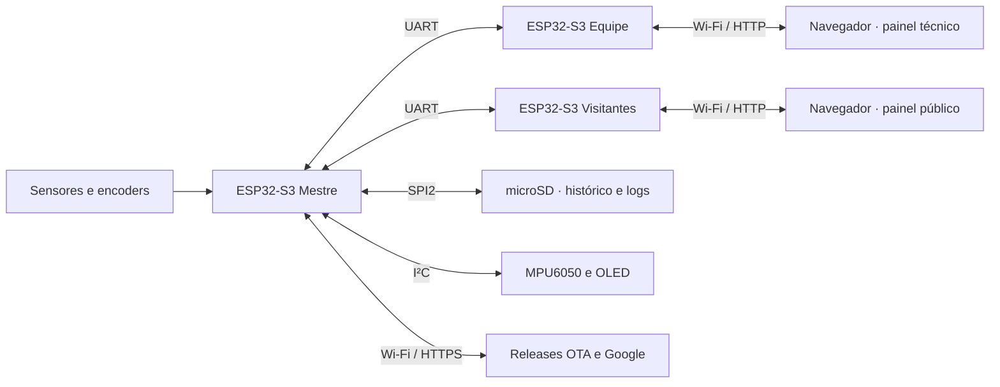

# Arquitetura do sistema

[Índice da documentação](README.md)

Para as decisões de divisão do código, contratos entre camadas e exemplos de
fluxos completos, leia também [filosofia do código](filosofia.md).

O NEXUS possui um mestre responsável pelos sensores e dois satélites dedicados
à apresentação. Essa separação mantém a aquisição independente da quantidade de
clientes Wi-Fi e permite atualizar ou reiniciar uma interface sem interromper as
demais funções do veículo.

As setas duplas representam troca de dados nos dois sentidos, não duas redes
compartilhadas: o mestre tem uma UART independente para cada satélite. A
telemetria segue do mestre para os satélites; ACK, respostas a comandos e
confirmações de OTA voltam pelo respectivo enlace. O painel se comunica por
Wi-Fi com seu próprio satélite, não diretamente com o mestre. Veja
[conceitos e periféricos](conceitos.md) para os termos do diagrama.

## Responsabilidades

Cada firmware é um projeto PlatformIO independente. Os contratos binários ficam
em `firmware/compartilhado`, evitando cópias divergentes entre os três projetos.

No mestre:

- `nucleo` reúne configurações de placa e políticas estáticas;
- `gerenciadores` encapsula drivers e periféricos do ESP-IDF;
- `dispositivos` representa componentes físicos, como MPU6050, encoders e ADC;
- `servicos` implementa regras de aplicação, diagnóstico, telemetria e OTA;
- `main.cpp` inicializa os módulos e coordena o fluxo periódico.

Nos satélites:

- `servicos/receptor_uart` valida a telemetria, mantém o último retrato e
  encaminha quadros de comandos e OTA aos serviços compartilhados;
- `gerenciadores/gerenciador_wifi` mantém o ponto de acesso local;
- `servicos/servidor_web` publica o painel e as APIs HTTP;
- somente na equipe, `gerenciadores/gerenciador_uart` serializa as consultas
  feitas pelo painel ao mestre e `servicos/diagnostico_sistema` mede o estado local.

## Fluxos de dados

A aquisição produz um conjunto de leituras, com valores físicos nas unidades
usadas pelo painel quando disponíveis, além de indicar quais leituras são
válidas. O serviço de telemetria
o converte para o protocolo compacto e enfileira uma cópia para cada UART. Os
satélites só substituem o retrato publicado depois de validar cabeçalho, tamanho,
versão e CRC. Eles devolvem ACK de telemetria e respostas a comandos e OTA pelo
fio de retorno de cada UART. As confirmações permitem medir atraso, perdas e
disponibilidade. A equipe expõe consultas e ações do mestre por HTTP; o módulo
de visitantes expõe somente a telemetria pública.

O mesmo retrato é amostrado a 1 Hz pelo serviço de registro. Uma tarefa é a única
proprietária dos CSVs no cartão SD; por isso, aquisição e transmissão não esperam
gravações. O envio ao Google ocorre somente por solicitação e não faz parte do
caminho de tempo real.

Na atualização completa, o mestre transfere e confirma primeiro os dois
satélites. Sua própria atualização só começa depois dessa etapa, preservando o
controlador que coordena a operação até o fim.

## Falhas e recuperação

Gerenciadores retornam o `esp_err_t` original. Serviços decidem se devem repetir,
degradar uma função ou publicar uma falha; a aplicação decide se a inicialização
pode continuar. Diagnóstico e supervisão mantêm contadores e idade da última
resposta, enquanto OLED, terminal e painel web apresentam o estado sem acessar
diretamente os drivers.

Falhas de um recurso opcional, como tela, cartão SD ou Wi-Fi externo, não devem
interromper a telemetria UART. Falhas em tarefas e enlaces possuem recuperação
isolada. Operações remotas carregam um identificador de solicitação, e respostas
recentes são memorizadas para que uma repetição não execute novamente uma ação
com efeito colateral.

As regras internas do mestre seguem abaixo. O comportamento das interfaces e
dos enlaces dos satélites está no [guia dos satélites](satelites.md).

## Arquitetura interna do mestre

O código ativo está dividido por responsabilidade:

- `nucleo`: configuração de placa, Wi-Fi e OTA.
- `gerenciadores`: acesso genérico aos periféricos do ESP-IDF. Não conhecem o formato da telemetria.
- `dispositivos`: regras específicas de cada componente físico, como MPU6050 e entrada ADC.
- `servicos`: funcionalidades da aplicação, como telemetria, diagnóstico, Wi-Fi,
  OTA, sinalização e menu do terminal serial.
- `main.cpp`: inicialização e coordenação periódica. Não acessa periféricos diretamente.

As dependências devem seguir somente essa direção: `nucleo` e protocolos
compartilhados → gerenciadores → dispositivos → serviços → apresentação e
`main.cpp`; cada camada à direita só pode depender das camadas à esquerda.
Cabeçalhos públicos de serviços não devem agregar tipos concretos de
outros serviços ou gerenciadores. O retrato de diagnóstico, por isso, publica
tipos neutros próprios e é preenchido apenas na implementação.
Dependências entre serviços devem ser unidirecionais; quando dois serviços
precisarem colaborar sem uma hierarquia natural, `main.cpp` registra um callback
ou compõe a operação, evitando referências recíprocas.

Inicializações que possuem mais de uma etapa são transacionais: em caso de
falha, tarefas, filas, mutexes, registros de supervisão e drivers criados pela
operação são liberados em ordem inversa. Chamadas de inicialização concluídas
são idempotentes. Funções assíncronas usam nomes que deixam o contrato claro;
por exemplo, `gerenciador_uart_enfileirar` confirma a cópia para a fila, enquanto
ACK, timeout e repetição pertencem aos protocolos de telemetria, comandos e OTA.

Os gerenciadores preservam o código de erro do ESP-IDF. Os serviços decidem
tentativa, degradação e recuperação, e `main.cpp` decide se a falha impede a
execução. Resultados esperados, como endereço I2C sem ACK durante uma sondagem,
não entram no mesmo contador de falhas do barramento. O diagnóstico registra
totais, falhas consecutivas e instantes da primeira e da última ocorrência dos
sensores, sem alocação dinâmica.

### Estado atual

UART, I2C, PCNT, cartão SD e OTA possuem implementação funcional. O serviço
`servico_gravador_audio_treinamento` usa I2S com um INMP441 para coletar WAVs de
treinamento por comando do terminal; esse recurso é temporário e não participa da
aquisição contínua de telemetria.

O OTA usa Wi-Fi em modo estação, HTTPS com o pacote de certificados do ESP-IDF,
manifesto único no GitHub Release, SHA-256, duas partições de aplicação e rollback.
A orquestração e a autorização ficam em `servicos/servico_ota.cpp`. A gravação do
mestre fica no gerenciador OTA; o download e o transporte confirmado para os
satélites ficam em `transporte_ota_satelites`. `servico_enlace_satelites` é o único
proprietário da inicialização e da supervisão das UARTs dos satélites. Ele consome
os quadros de retorno e encaminha cada tipo ao serviço correto. O
`servico_telemetria` apenas monta e publica os dados e acompanha as confirmações;
ele não controla tarefas nem drivers de comunicação.

As conexões Wi-Fi são sessões temporárias. O gerenciador mede RSSI, canal e motivo
de desconexão, enquanto o serviço decide a prioridade dos perfis, as autorizações
e quando o rádio deve entrar em repouso.

`servicos/servico_wifi.cpp` mantém a política de redes: prioridade da rede principal,
perfis secundários persistidos na NVS, autorização manual e modo automático
protegido por senha. `gerenciadores/gerenciador_wifi.cpp` cuida apenas da conexão e
da troca de credenciais no ESP-IDF. Assim, terminal e telemetria podem usar a mesma
API sem duplicar regras.

`servicos/servico_diagnostico.cpp` reúne as estatísticas dos módulos, publica uma
classificação de saúde atualizada periodicamente e oferece um agregado único para
as interfaces de observabilidade. `servicos/servico_relatorios.cpp` é responsável pela
formatação, periodicidade e pausa dos relatórios e consulta diagnóstico, comandos
e demais serviços sem criar dependências de retorno entre eles. O terminal apenas
apresenta e edita essas opções. O `main.cpp` inicializa a
NVS global, inicia os módulos e coordena a aquisição periódica. O modelo
`compartilhado/telemetria/dados_telemetria_veiculo.h` impede que o serviço de
telemetria dependa diretamente do MPU6050 ou do simulador.

Os comandos remotos executam consultas e ações pelos contratos públicos dos
serviços. Para ações de interface, como solicitar um resumo, o `main.cpp`
registra a função correspondente no serviço de comandos. Isso mantém comandos e
relatórios sem dependência circular.

`servicos/servico_simulador_telemetria.cpp` é uma fonte substituível de dados de
teste. Ele simula movimento, bateria, posição e sensores de proximidade, mas não
conhece UART nem páginas web. O `main.cpp` usa a configuração como estado inicial;
o comando remoto da equipe pode trocar a fonte durante a sessão. Em ambos os
casos, entrega o mesmo modelo ao `servico_telemetria` usado pelos sensores reais.

A transmissão UART usa uma fila independente por destino. O protocolo compartilhado
v4 identifica versão, tipo e tamanho da carga, transporta as grandezas processadas
do MPU6050 e protege o quadro com CRC-16. Assim,
o ciclo de aquisição não aguarda a conclusão física de cada transmissão e os
receptores conseguem distinguir corrupção, incompatibilidade e conteúdo inválido.
Os satélites devolvem uma confirmação curta para cada quadro válido. O serviço de
telemetria mede, separadamente, RTT atual, médio e máximo e a idade da última
resposta dos módulos da equipe e dos visitantes.

Na OTA dos satélites, download HTTPS e envio UART avançam em paralelo. Três
buffers de 4 KiB são alocados uma única vez, preferencialmente na PSRAM, e
reutilizados durante toda a execução. O callback HTTP somente preenche e enfileira
blocos; uma tarefa persistente monta o quadro em RAM interna, transmite e aguarda
a confirmação. Assim, a rede pode preencher o próximo bloco enquanto a UART
confirma o anterior, sem alocação por bloco e sem usar PSRAM como memória DMA.
Quando a PSRAM não está disponível, a inicialização tenta a RAM interna e informa
a degradação no registro.

O buffer de recepção do manifesto também é reservado uma única vez na
inicialização do serviço OTA e reutilizado nas verificações periódicas. Dessa
forma, apenas as estruturas transitórias do analisador JSON permanecem dinâmicas.

A apresentação ao vivo usa um retrato a 4 Hz. Em paralelo,
`servico_registro_telemetria` reduz esse mesmo retrato para 1 Hz e o entrega por
fila a uma única tarefa proprietária dos CSVs. O arquivo ativo é sincronizado a
cada dez segundos, fechado a cada hora ou 8 MiB e recuperado após reinicialização.
Se o cartão não estiver disponível na partida, o mestre mantém a telemetria ao
vivo e tenta habilitar novamente o histórico a cada trinta segundos.
O upload é iniciado explicitamente, abre uma sessão Wi-Fi temporária, transmite
o CSV em blocos com progresso compartilhado com o painel local, exige confirmação
nominal do Google e só então move o CSV para `enviados`. O gerenciador do cartão
conhece apenas SPI e montagem FAT; toda a política permanece no serviço.

Os gerenciadores retornam `esp_err_t`. O código chamador deve sempre verificar o
resultado antes de usar os dados ou avançar para a próxima etapa.

`gerenciador_contador_pulsos` mantém duas instâncias genéricas do periférico PCNT
e conta as quatro transições de cada par A/B, sem identificar o sentido de
rotação na configuração atual. Os dispositivos
`encoder_incremental` representam os encoders físicos esquerdo e direito e
conhecem pinos, P/R e contagens por giro. `servico_odometro` aplica a geometria e
a relação mecânica de cada roda, usa a média das duas distâncias para calcular
velocidade, percurso e distância total e persiste o odômetro periodicamente na
NVS. O percurso é reiniciado com o firmware; a distância total é recuperada após
reinicializações. O serviço também limita saltos incompatíveis com a velocidade
máxima configurada e diagnostica divergência persistente entre as rodas, sem
alterar a média usada pelo odômetro.

`gerenciadores/gerenciador_indicadores.cpp` contém apenas o acesso aos quatro LEDs
e ao PWM do buzzer passivo. `servicos/servico_sinalizacao.cpp` interpreta os
estados de saúde, Wi-Fi e OTA, escolhe o padrão visual e agenda melodias sem
bloquear as outras tarefas. A avaliação dos serviços ocorre a cada 500 ms; a
máquina de LEDs e notas avança a cada 50 ms.

`dispositivos/tela_ssd1306.cpp` implementa o controlador OLED, a fonte e o
framebuffer usando exclusivamente a API do `gerenciador_i2c`. O
`servicos/servico_painel_local.cpp` consulta o estado já classificado pelo serviço
de sinalização e apresenta inicialização, saúde, Wi-Fi e OTA. A tela compartilha o
barramento do MPU6050 e só recebe um novo quadro quando o conteúdo realmente muda.
Uma falha do painel é isolada e não interrompe a telemetria.

O painel também mantém uma fila de mensagens de tamanho fixo. A inicialização
publica etapa e percentual sem espera artificial; avisos são copiados para a fila
e exibidos depois da partida. Estados persistentes usam janelas recorrentes, de
forma que um alerta continua sendo lembrado sem monopolizar permanentemente a
tela. Nenhuma mensagem faz alocação dinâmica durante a operação.

`servicos/servico_supervisao.cpp` acompanha pulsos da tarefa de telemetria e dos
dois canais UART. Cada alvo possui tempo limite compatível com o maior intervalo
configurável e recuperação independente. O diagnóstico mede a margem de pilha das
tarefas por um retrato do FreeRTOS. Os canais UART são recuperados restaurando filas, buffers,
pinos e velocidade sem reiniciar o restante do mestre; a tarefa de telemetria não
é apagada à força enquanto pode estar usando um periférico.

#### Escalonamento e diagnóstico de recursos

`include/nucleo/configuracao_tarefas.h` centraliza nomes, pilhas, prioridades e
afinidades; cada serviço continua responsável pela criação e pelo ciclo de vida.
Aquisição, telemetria e enlaces ficam no núcleo 1; OTA, upload e registro SD no
núcleo 0. Painel, terminal, sinalização, relatórios e supervisão ficam sem afinidade
fixa. Isso não reserva núcleos: tarefas do ESP-IDF também são escalonadas neles.
Pilhas e buffers UART existentes foram preservados para ajuste posterior com
medição sob TLS, OTA e recuperação. Buffers DMA continuam sob as restrições dos
drivers; PSRAM não substitui indiscriminadamente memória interna/DMA.

As medições em bancada mostraram margens mínimas de 124 bytes na tarefa `main`
durante a inicialização e 492 bytes em `sys_evt` após o uso do Wi-Fi. Por isso,
somente essas pilhas do ESP-IDF foram ajustadas: `main` para 6144 bytes e a tarefa
de eventos do sistema para 4096 bytes. O diagnóstico registra também o nome da
tarefa com a menor margem, evitando aumentos indiscriminados.

A supervisão de prioridade alta apenas detecta e enfileira recuperações; a tarefa
`recuperacao`, de prioridade 4, executa as ações potencialmente bloqueantes.
Aquisição, SD, upload e OTA também informam fase e prazo de atividade; espera ociosa
tem prazo zero. Atrasos desses serviços geram diagnóstico, sem apagar tarefas à
força. Os prazos de rede são maiores que os de aquisição.

O diagnóstico coleta até 48 tarefas a cada cinco segundos, incluindo tarefas do
SDK, com prioridade, afinidade, estado, menor margem de pilha e CPU por janela.
CPU de 100% representa um núcleo; a primeira janela não possui medição. Os campos
de núcleo representam afinidade, não o núcleo instantâneo de execução. Uma coleta
sem capacidade é marcada inválida. Relatórios de tarefas são emitidos a cada 30 s;
suas cópias e as do log usam PSRAM, sem alocação por mensagem. O diagnóstico
mede RAM interna acessível em bytes e o maior bloco alocável. Atenção só ocorre
após 15 amostras abaixo de 24 KiB livres ou 8 KiB de bloco; falha, após 3
amostras abaixo de 16 KiB ou 4 KiB. Abaixo de 8 KiB livres ou 2 KiB de bloco,
a falha é imediata. A recuperação exige 5 amostras fora da faixa de pressão.

O resumo solicitado pela opção 1 do terminal é separado por seções e aguarda a
impressão terminar antes de redesenhar o menu. A tabela de tarefas é ordenada pela
menor margem de pilha e usa estados textuais, compatíveis com monitores seriais
sem ANSI. O resumo informa ainda o estado visual comandado e se o verde contínuo
é esperado; isso confirma a decisão do software, mas não detecta LED aberto,
resistor, polaridade ou ligação física incorreta.

#### Registro de diagnóstico no cartão

A tarefa de registro existente também mantém `/sdcard/logs/esp_00000001.log`,
`esp_00000002.log` e assim por diante, em sequência global no cartão.
Grava versão do firmware/IDF, chip, flash, motivo numérico do último reset, memória
interna/PSRAM/DMA, pilhas, CPU, erros dos sensores e comunicação, fases supervisionadas
e resultado dos uploads. Os tempos incluem milissegundos desde o boot e UTC
quando obtido de um cabeçalho HTTPS `Date` válido. Uma tarefa sem I/O no SD
guarda a 1 Hz as últimas 120 amostras compactas na PSRAM; se ela faltar,
guarda 30 amostras na RAM interna. O SD recebe um resumo a cada 30 s em
operação normal. Quando surge uma falha, recebe o histórico anterior e o
contexto do incidente, identificado por sequência, e passa temporariamente
à cadência de 2 s por 2 min ou 1 s por 5 min para falhas graves; novos erros
podem antecipar um registro, com limite de um por segundo. O lote é
liberado da RAM após sincronização no SD; se o cartão falhar, o primeiro lote
aguarda uma nova tentativa e os demais incidentes são contados. Há limite de
capturas por janela para evitar crescimento excessivo. Isso não é uma cópia
integral do console nem um core dump.

Os segmentos giram em aproximadamente 8 MiB e a sessão limita o diagnóstico a
aproximadamente 16 MiB (pode exceder pelo último registro). Ao atingir o limite,
somente o log para; CSV continua. Arquivos anteriores são preservados e não são
enviados ao Google. Não há retenção global: é necessário acompanhar o espaço livre
entre sessões. Cada registro é sincronizado e fechado; falhas de SD têm nova
tentativa em 30 s. Falha do cartão ou queda brusca de energia ainda pode impedir
a persistência do último evento. Credenciais não são incluídas.

O retrato `/sdcard/configuracao_atual.txt` usa checksum, sequência e arquivo
temporário recuperável. Após validar o arquivo, a partida restaura o odômetro,
a política e a preferência de conexão automática do Wi-Fi e o intervalo OTA
somente quando os dados NVS respectivos estiverem ausentes. Intervalos e pausa
dos relatórios são aplicados
antes de iniciar a tarefa de relatórios, que não usa NVS para esses ajustes.
Nomes das redes e parâmetros fixos do CSV permanecem informativos; senhas não
são copiadas ao SD, portanto perfis de rede não podem ser recriados a partir
dele. A regravação ocorre no mínimo 60 s após a última gravação concluída;
uma falha de escrita permite nova tentativa após 5 s, sem repetir o aviso a
cada amostra. A sequência do backup avança apenas após a gravação concluir.
Um corte de energia pode deixar cerca de 1 min de diferença em relação ao valor
mais recente.
